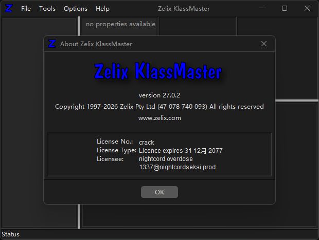
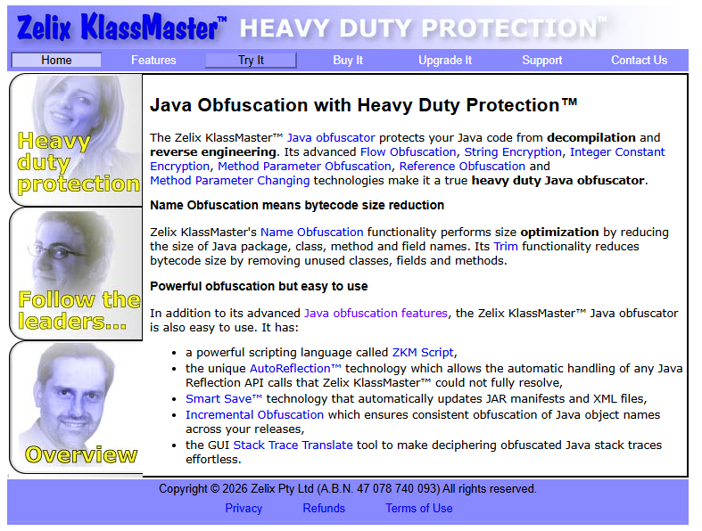
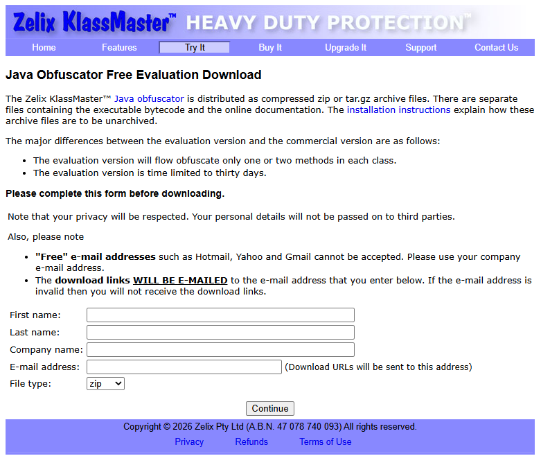
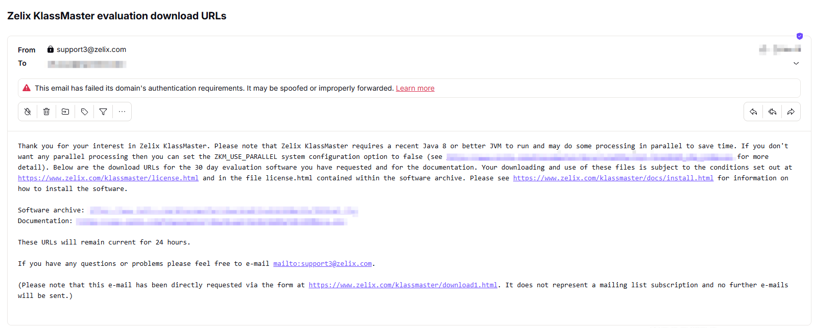
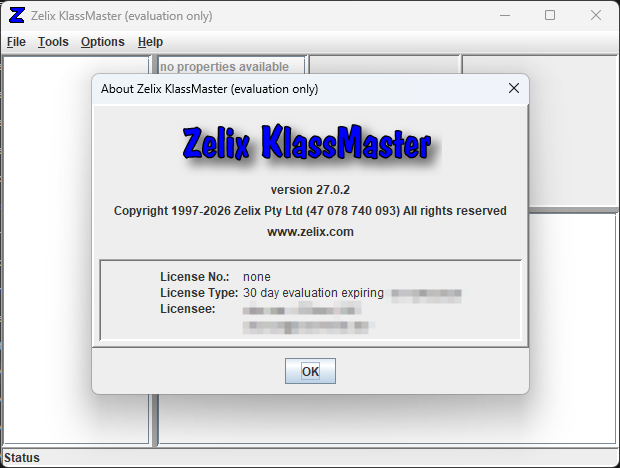

# 如何开裂ZKM 27.0.2

> 点击输入文本

<p align="center">
  
</p>

> The Zelix KlassMaster™ Java obfuscator protects your Java code from decompilation and reverse engineering. Its advanced Flow Obfuscation, String Encryption, Integer Constant Encryption, Method Parameter Obfuscation, Reference Obfuscation and Method Parameter Changing technologies make it a true heavy duty Java obfuscator.
>> Zelix KlassMaster™ Java 混淆器能够保护你的 Java 代码，防止其被反编译和逆向工程。
>>
>>它采用了多种先进的代码保护技术，包括：
>>- 流程混淆（Flow Obfuscation）
>>- 字符串加密（String Encryption）
>>- 整数常量加密（Integer Constant Encryption）
>>- 方法参数混淆（Method Parameter Obfuscation）
>>- 引用混淆（Reference Obfuscation）
>>- 方法参数修改（Method Parameter Changing）
>>凭借这些强大的技术，Zelix KlassMaster™ 成为一款真正意义上的重型 Java 代码混淆保护工具，能够为 Java 程序提供高强度的反编译与逆向工程防护。

<a href="https://zelix.com">Zelix KlassMaster™</a>作为在<a href="https://zh.wikipedia.org/wiki/Java%E8%99%9A%E6%8B%9F%E6%9C%BA">JVM</a>圈子里面一个<a href="https://baike.baidu.com/item/%E8%B5%84%E5%8E%86">资历</a>非常之古老地位非常之高的<a href="https://zh.wikipedia.org/wiki/%E4%BB%A3%E7%A0%81%E6%B7%B7%E6%B7%86">混淆</a><a href="https://zh.wikipedia.org/wiki/%E5%B7%A5%E5%85%B7">工具</a>，其凭借着强大的<a href="https://zh.wikipedia.org/wiki/%E8%AE%A1%E7%AE%97%E6%9C%BA%E4%BB%A3%E7%A0%81">代码</a>混淆能力，多年以来一直都是许多程序所采用的混淆工具。  

然而Zelix KlassMaster™(下文简称ZKM)太他妈的昂贵了！我操，你敢想象一个混淆工具卖他妈的至少290$ 并且还他妈的绑定你的Location/Hardware ID吗，我们伟大的ZKM做到了。  
多年以来一堆人都他妈只能对着这个美丽的混淆器流口水，并且由于是穷逼兜里无法多出空闲的290$ 购入这个混淆器。  

不过没有关系，本文将会简单介绍一下如何<a href="https://zh.wikipedia.org/wiki/%E8%BD%AF%E4%BB%B6%E7%A0%B4%E8%A7%A3">破解</a>这个狗操的售卖至少290$的混淆器。
> 尽管<a href="https://zh.wikipedia.org/wiki/%E5%A4%A7%E5%9E%8B%E8%AF%AD%E8%A8%80%E6%A8%A1%E5%9E%8B">溜溜梅</a>承担了91.7867%以上的工作。

## aconst_null
首先显而易见的我们需要获取一份ZKM本体。  

<p align="center">
  
</p>

在打开这个仿佛来自于<a href="https://zh.wikipedia.org/wiki/Y2K%E7%BE%8E%E5%AD%A6">y2k</a>的网站之后，我们可以非常简单的看到网站的Header里面有一个Try it选项。

<p align="center">
  
</p>

这里我们无法使用任何<a href="https://zh.wikipedia.org/wiki/%E4%B8%BB%E6%B5%81">主流</a>的邮箱后缀。所以这里笔者使用了一个自定义的<a href="https://zh.wikipedia.org/wiki/%E5%9F%9F%E5%90%8D">域名</a>后缀进行表单的填写和下载。  
这个<a href="https://zh.wikipedia.org/wiki/%E7%B6%B2%E9%A0%81%E8%A1%A8%E5%96%AE">表单</a>唯一验证的似乎只有邮箱后缀。名字和公司名字你哪怕写个<a href="https://zh.wikipedia.org/wiki/%E9%AB%98%E5%B8%82%E6%97%A9%E8%8B%97">高市早苗</a>, LLC都他妈的可以随随便便通过这个表单验证。  
接着你的邮箱里面将会多出一封来自support3@zelix.com的邮件。里面附带有你的试用版本ZKM下载地址。  

<p align="center">
  
</p>  

> 然后非常奇异搞笑的一点是这一封邮件进入了笔者所使用的Proton Mail的Spam邮件分类里面。  
> 并且显而易见的笔者也是穷逼无法购入一个价值290$ 的混淆器。

# iconst_0
<p align="center">
  
</p>
接下来让我们动用不需要消耗<a href="https://zh.wikipedia.org/wiki/%E8%AF%8D%E5%85%83">词元</a>的<a href="https://zh.wikipedia.org/wiki/%E5%A4%A7%E8%84%91">大脑</a>进行一<a href="https://zh.wikipedia.org/wiki/%E6%99%AE%E6%9C%97%E5%85%8B%E6%99%82%E9%96%93">普朗克时间</a>的思考之后可以得出这个本体一定是带有混淆的jar包。  

> 哎呦他妈的剩下的东西我懒得写了所以接下来全部都是DeepSeek V4.1 Flash 1017写的然后我人工操操操！

具体来看，它至少叠了四层：

- **<a href="https://zh.wikipedia.org/wiki/%E5%AD%97%E7%AC%A6%E4%B8%B2">字符串</a>加密**。所有字符串常量都不在常量池里躺着，运行时才解密。
- **控制流混淆**。一个二十行的<a href="https://zh.wikipedia.org/wiki/%E6%96%B9%E6%B3%95_(%E9%9B%BB%E8%85%A6%E7%A7%91%E5%AD%B8)">方法</a>能他妈给你拆成三百条指令，到处是 `goto` 拼接。
- **<a href="https://zh.wikipedia.org/wiki/%E5%B8%B8%E6%95%B8_(%E7%B7%A8%E7%A8%8B)">常量</a>加密**。`ldc` 出来的 long 全是 `-3052448724462366969` 这种<a href="https://zh.wikipedia.org/wiki/%E7%B3%9E%E4%BE%BF">狗屎</a>。
- **`invokedynamic` 派发**。大量方法调用被换成了 `indy`，你得去 `BootstrapMethods` 里反查真实目标。

# iconst_1

最开始的思路很简单直接，使用Java Agent机制对JVM进行<a href="https://zh.wikipedia.org/wiki/%E8%B0%83%E8%AF%95">调试</a>。

结果：

```text
Exception in thread "main" javax.crypto.BadPaddingException
```

用<a href="https://zh.wikipedia.org/wiki/%E8%82%9B%E9%97%A8">屁眼子</a>都能猜到这种商业产品不上反Java Agent调试那他妈才是神了。

稍微跟一下就发现，崩在 `com.zelix.nxq.<clinit>` 里。这个<a href="https://zh.wikipedia.org/wiki/%E7%B1%BB_(%E8%AE%A1%E7%AE%97%E6%9C%BA%E7%A7%91%E5%AD%A6)">类</a>在初始化的时候会去读系统属性，一旦看到 `-javaagent` 或者 `-agentlib:jdwp`，它解密出来的东西就是狗屎的——换句话说，它**故意**让后面的解密全爆炸。

有意思的是这个判断点非常具体。在 `com.zelix.x__` 里，有一条：

```text
bipush 10
```

把它改成：

```text
bipush 17
```

一个字节的事，`0x0A` → `0x11`，检测就失效了。改完之后 `-javaagent` 随便挂上去操。！

> 不过后来还是放弃了 agent 方案。原因有两个：一是这个zkm他妈的到处都他妈有Agent 检测暗桩；二是最终出来的应该是一个**纯字节码**的产物——用户双击就跑，不带任何启动参数。所以后面所有的改动，全都是往 class 文件里写死的。

# iconst_2

接下来是正题：怎么害死许可证机制

ZKM 的许可证信息全部来自 `com.zelix.ij` 这个类。它有一个字段：

```java
static String[] f;   // 长度 17
```

运行时把 17 个槽位打印出来，长这样：

```text
f[0]  "License No.:"
f[1]  "License Type:"
f[2]  "Licensee:"
f[3]  <二进制 blob>
f[4]  "30 day evaluation expiring"
f[5]  "VlW5eF8fq"
f[6]  "Not used"
f[7]  "none"                              <- 许可类型
f[8]  "9191787867"
f[9]  "WHa6SUKKUK"
f[10] "占位符@占位符.操你妈"               <- 邮箱
f[11] "WHa6SUKKUK"
f[12] ""
f[13] "9191787867"
f[14] "VlW2eF8Fq"
f[15] "Not used"
f[16] "我不知道"             <- 组织
```

要改的东西一目了然：

```text
f[4]   "30 day evaluation expiring"  ->  "Licence expires"
f[7]   "none"                        ->  "crack"
f[10]  "占位符@占位符.操你妈"         ->  "1337@nightcordsekai.prod"
f[16]  "我不知道"       ->  "nightcord overdose"
```

`f[7]` 这一项特别值得说。它不是随便一个字符串，而是直接拼在标题栏上的。改成 `crack` 之后，整个工具抬头就变成：

```text
Zelix KlassMaster 27.0.2 - License #crack
```

## The date is a lie

这里有个非常反直觉的发现。

按常识，试用期一定有个校验点，找到它，把它改掉，就永久了。于是我花了不少时间在 `im` 那个类里翻日期比较的逻辑。

结果试着把到期日改成 **2020 年**——已经过期六年了——工具照样跑，功能一个不缺。

也就是说，**这傻逼ZKM根本没有到期校验**。那个「30 day evaluation expiring」纯粹是奇异搞笑的东西。

感谢 Zelix Pty Ltd 为我省了不知道多少事。爱你。

# iconst_3

试用版绝大多数都会耀武扬威让别人知道你用的是低人一等的试用版本而不是正式版本。ZKM也是如此。

在 `com.zelix.nmx` 里：

```java
static String h = "ZKM27.0.2E";
```

它会被写进每一个输出类里——常量池、注解、或者别的什么臭狗屎角落。

处理方式很粗暴：在 `nmx.<clinit>` 里，把 `h` 赋值成空串。

验证方法也很粗暴，拿混淆结果去 grep：

```python
# 遍历输出的 240 个 class，在常量池的 utf8 项里找 "ZKM27"
for i in range(1, len(cp)):
    if b"ZKM27" in cp[i]:
        hits += 1
```


# iconst_4

ZKM自己会往控制台和 `ZKM_log.txt` 里打横幅。暴力操。！之后关于页面是对的，但日志里还是老样子——因为写日志走的是另一个路子。

日志的 writer 是 `com.zelix.rg`，`ZKM_log.txt` 这个字面量就攥在它手里。

思路是：不去改它打印的内容，而是在 `PrintStream` / `PrintWriter` 外面套一层。凡是 `new PrintStream(...)` 的地方，全换成自己的包装类，在 `write` 的时候顺手把文本改掉。

听起来简单，踩了个特别蠢的坑。

第一版的正则是这样：匹配日期然后替换。跑出来日志变成：

```text
Licence expires 13131 3131 3131 3131 3131 …
```

因为替换不是幂等的——替换完之后新文本又匹配上了同一个正则，然后再替换一次，如此往复。一个「31」被反复加工成了这坨狗屎。

修法是把匹配结果一次性算好，用 `Matcher.replaceAll` 走单遍，并且加上幂等约束：第二次看到已经正确的文本就什么都不做。

```java
String out = DATE.matcher(input).replaceAll("31 12月 2077");
```

# iconst_5

命令行对了，但 ZKM 主要是个图形工具，`ZKM.jar` 双击起来是 Swing 界面，那边还是老样子。I mean, why not fuck it?

## Fuck it

ZKM原版的界面是默认Swing主题。出于奇异搞笑的因素，这里笔者往里面塞了 FlatLaf。

关键是**注入点**。第一版插在 `main` 方法开头，结果毫无效果。

事实上ZKM 的许可证弹窗是在 `ZKM.<clinit>` 里就建好的，等 `main` 开始执行的时候，界面已经操完了，你再设 LAF 也影响不到已经创建出来的组件。

所以注入点应该是 `com.zelix.ZKM.<clinit>`，在静态初始化最开始插入：

```java
zkmfix.L.install();
zkmfix.T.install();
```

# lconst_0

ZKM 有四个类：`im`、`ij`、`p8`、`nmz`。

这四个类，**一个字节都操不得**。

不是「操了会崩」，是他妈的「操了之后某个特定功能会崩」。具体来说：

```text
动 im / ij / p8 / nmz  ->  aggressive 模式混淆直接失败
                        报 Inconsistent stack heights
light / normal / default -> 没事
```

笔者一开始不信邪，觉得让<a href="https://zh.wikipedia.org/wiki/%E5%A4%A7%E5%9E%8B%E8%AF%AD%E8%A8%80%E6%A8%A1%E5%9E%8B">溜溜梅</a>改点无关紧要的应该没问题。试过这些：

- 改 `SourceFile` 属性的类名
- 翻转一个 `ACC_SYNTHETIC` 标志位
- 加一个空的、谁都不读的自定义属性
- 对一个从来没被调用的两字节方法做 NOP

**全都死。** 而且只有在 `obfuscateFlow=aggressive` 的时候炸，换个档位就什么事都没有。

这明显是 ZKM 对自己做了一层完整性校验，而且校验输入直接影响它控制流分析的状态。所以这四个类只能绕开走——所有改动都放在别的类里。

# fconst_1

拿到手之后怎么用？你应该去询问<a href="https://doubao.com">豆包</a>或者前往<a href="https://www.smhc.org.cn">这个地方</a>而不是在这里寻找教程。

# return

没有return。也没有Download Link。如果你路子广你应该知道去哪里获得这个crack。